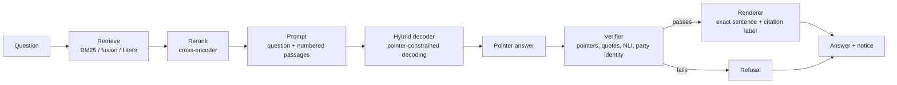

# Architecture

`lexhybrid` is a retrieval-gated answer pipeline around a small hybrid language model. The model
never writes statute text. It writes short free text and *pointers* into numbered retrieved
passages; a renderer replaces each pointer by the exact source sentence and its citation label, and
a verifier decides whether the result may be shown.

This document describes the code as it is in the repository. The project is an actively developed
research codebase; no trained weights are released.

## Answer pipeline



The pieces exist as library modules (`lexhybrid/retrieval`, `lexhybrid/data/sft_format.py`,
`lexhybrid/decoding`, `lexhybrid/verifier`, `lexhybrid/renderer`). There is not yet a single
command-line entry point that runs the whole chain.

## Model

`lexhybrid.models.hybrid_lm.HybridLanguageModel` is a decoder-only stack: token embedding, N blocks,
final RMSNorm, LM head (tied to the embedding by default). Each `HybridBlock`
(`lexhybrid/layers/hybrid_block.py`) is pre-norm, mixer, residual, then an MLP. The mixer type is
chosen per layer by `layer_pattern`; the types are:

| Mixer | Module | Role |
|---|---|---|
| `mamba3` | `layers/mamba3_block.py` | Mamba-3 state-space layer (chunked SSD scan, `kernels/ssd`) |
| `mlstm` | `layers/mlstm_block.py` | xLSTM matrix-memory layer (TFLA chunked kernels, `kernels/tfla`) |
| `attention` | `layers/attention_block.py` | causal self-attention with RoPE, document-boundary masking, KV cache |
| `mamba` | `layers/mamba_block.py` | Mamba-1 layer, kept for the legacy-operator ablation |

Recurrent layers and attention all reset at document boundaries in a packed row (`doc_ids`), and
all support cached decoding (recurrent state or KV cache).

The base configuration, `configs/model/hybrid_legal_base.yaml`:

| Property | Value |
|---|---|
| Layers | 12: `mamba3 x3, attention, mlstm x3, mamba3 x2, attention, mamba3 x2` |
| Width | 768; 12 heads of 64 for mLSTM and attention |
| Vocabulary | 151,936 rows (Qwen3 tokenizer plus pointer tokens, padded) |
| Maximum positions | 8,192 (RoPE, `rope_theta` 500,000) |
| Parameters | 104,066,872 non-embedding, 220,753,720 total (see `analysis/param_counts.md`) |
| Norm topology | HybridNorm; QK-norm in attention |
| Operators | exact chunked scan (`scan_impl: exact`, `tfla_impl: exact`) |

`configs/model/` also holds the matched Transformer (`transformer_legal_base`), the architecture
variants used in the architecture screen (no attention, four attention layers, Mamba-3 `d_state`
64, multi-token prediction; see `analysis/screen_results.md`), a legacy-operator ablation, and replicas of the upstream reference
implementation used for parity checks. Every config declares all `HybridConfig` fields, and
`scripts/check_configs.py` composes each one through Hydra.

Kernels (`lexhybrid/kernels/`) are plain PyTorch: chunked SSD, TFLA for mLSTM, and a selective scan
for Mamba-1. There are no hand-written CUDA or Triton kernels; Triton code appears only when a model
runs under `torch.compile`.

## Tokenizer and pointer vocabulary

The tokenizer is Qwen3's own (`lexhybrid/data/tokenizer.py`), pinned to a revision. Its EOS,
`<|endoftext|>`, ends every document. 87 special tokens take ids 151,669 to 151,755 and appear only
in supervised pointer data, never in pretraining text:

```
<|q|> <|cite|> <|c1|>..<|c16|> <|s1|>..<|s64|> <|unanswerable|>
<|passage|> <|/passage|> <|question|> <|answer|>
```

`encode_document` tokenizes raw text so that no special token can come from document content.

The prompt format (`lexhybrid/data/sft_format.py`) is one document: `<|question|>` and the question,
then up to 16 `<|passage|>` blocks, each opening with `<|cK|>` and its citation header and holding
up to 64 sentences marked `<|s1|>`..`<|s64|>`, then `<|answer|>`. The answer mixes free text with
pointers:

- `<|q|><|cK|><|sJ|>` quotes sentence J of passage K (a run of consecutive sentences is a span);
- `<|cite|><|cK|>` cites passage K, optionally with its sentences;
- `<|unanswerable|>` is the whole answer when the passages do not support one.

## Decoding

`lexhybrid/decoding/generate.py` implements greedy, sampling and beam search, each in an uncached
form (recompute the full forward pass) and a cached form (one step through recurrent state and KV
caches). Both share one selection core (repetition penalty, EOS handling, beam ranking), so a cached
decoder differs from its reference only through the logits; tests bound that difference.
`best_of_n` draws n cached samples for one prompt and returns the one a caller-supplied scorer rates
highest (for example a verifier-based score).

`lexhybrid/decoding/pointer_constraints.py` provides `PointerFSM`, a logit mask that makes an
invalid pointer impossible to decode: a chunk id may only follow a marker and only name a retrieved
chunk; a sentence id may only follow its own chunk id; a pointer cannot be left dangling; the
prompt-structure tokens are never generated; with nothing retrieved the pointer markers are masked.
`validate_pointers` checks a finished token sequence.

## Training

Entry point: `scripts/train_pretrain.py` (PyTorch Lightning, Hydra configs under `configs/`).
Packed rows carry `doc_ids`; the loss never asks a document's last token to predict the next
document's first. Related code is in `lexhybrid/training/`.

- **Slab loss** (`models/slab_loss.py`): cross-entropy over the 151,936-token vocabulary computed
  slab by slab along the sequence under activation checkpointing, so the full `(B, L, V)` logits are
  never held.
- **Multi-token prediction** (`models/mtp_head.py`): an optional training-only head (`mtp_n > 1`,
  off in the base config) in the sequential form of DeepSeek-V3; it is discarded at inference.
- **Distillation** (`training/distill.py`): online logit distillation from an open teacher
  (`configs/distill/`: Qwen3-1.7B-Base or Qwen3-8B-Base), `(1 - alpha) * CE + alpha * T^2 * KL`
  with alpha 0.5 and T 2 by default, also computed by slabs. Teachers see each packed document
  alone (per-document positions and a block-diagonal mask).
- **Schedule and optimizer**: warmup-stable-decay learning rate, AdamW with parameter groups
  (`training/schedulers.py`, `training/optimizer.py`).
- **Run metadata**: each run writes an architecture fingerprint line and `run_metadata.json`
  (`utils/arch_fingerprint.py`, `utils/run_metadata.py`), so a mis-configured run is visible in the
  first log lines.

## Retrieval

`lexhybrid/retrieval/` turns collected documents into the passages a prompt carries.

- **Chunking** (`chunking.py`): a statute chunk is one provision with its hierarchy, cut into
  numbered sentence units (Absatz, Satz, Nr., lit.), each labelled down to that grain; a decision
  is chunked part by part into windows of roughly 300 to 500 tokens. A chunk holds at most 64
  sentences.
- **Lexical search** (`bm25.py`): `bm25s` with German stemming.
- **Fusion** (`fusion.py`): reciprocal rank fusion over any number of rankings, so a lexical and a
  dense ranking can be combined without score calibration.
- **Rerank** (`rerank.py`): a cross-encoder scorer (`BAAI/bge-reranker-v2-m3` in production) picks
  the passages that go into the prompt under a chunk-count and token budget. Chunks that would
  overflow the budget are skipped, not cut, because passages are quoted by sentence.
- **Filters** (`filters.py`): jurisdiction (`DE`, `AT`, `CH`, `EU`), document type and
  valid-on-date filters. A chunk with no validity bounds is always kept.
- **Copies** (`copies.py`): a passage held by more than one source carries the other sources, so the
  rendered citation names every source.
- **Index manifests** (`index.py`): digests of the indexed documents, an index version registry and
  atomic writes, so an index can be checked against the current documents (`scripts/resync_index.py`).

`scripts/build_index.py` builds the BM25 index. A dense (bge-m3) index builder is not implemented
yet; the fusion and rerank code accept any ranking.

## Renderer

`lexhybrid/renderer/render.py` renders the pointer answer against the retrieved passages:

- `<|q|><|cK|><|sJ|>...` becomes `„<sentences, byte for byte>“ (<label>)`, with German quotation
  marks and a label such as `BGB §573 Abs. 2 Nr. 1`;
- `<|cite|><|cK|>` becomes `(<citation id>)`, with sentences it becomes their labels;
- text between pointers is copied unchanged;
- `<|unanswerable|>` and an answer with an empty body render as the refusal
  "Die bereitgestellten Quellen beantworten diese Frage nicht.";
- every answer, a refusal included, ends with
  "Hinweis: Dies ist eine rechtliche Information, keine Rechtsberatung."

`renderer/segments.py` defines the answer grammar once; the renderer and the verifier both read it.

## Verifier

`lexhybrid/verifier/verifier.py` checks a pointer answer before it is shown, claim by claim:

1. **Parse**: a malformed answer is refused.
2. **Party identity**: a question asking who a party was is refused, as is an answer containing a
   person placeholder or a name found by an optional NER callable. Refusal reasons never repeat a name.
3. **Pointers** (`pointers.py`): every pointer names a retrieved passage and existing sentences.
4. **Quotes** (`quotes.py`): a rendered quote equals its source after Unicode NFC and whitespace
   normalisation.
5. **Entailment** (`nli.py`): each claim must be entailed by the passages it cites. The NLI model is
   any `(premise, hypothesis) -> probability` callable; the production one is a multilingual
   mDeBERTa NLI model, with a 0.5 entailment threshold.

`verifier/leak.py` additionally detects scrubbed names that survive in an indexed chunk, using
keyed hashes from the scrub log, never the names. The result carries per-claim checks and a
citation-precision figure for evaluation.

## Data pipeline

```
collectors -> raw documents (+ manifests) -> scrub (LER) -> scrubbed documents -> dedup -> pack into shards -> pretraining
                                                           \-> chunk -> BM25 index -> retrieval
```

- **Collectors** (`lexhybrid/data/corpus/collectors/`): `gii`, `rii`, `oldp`, `eurlex`, `ris`,
  `fedlex`, `bger`, `dip`, plus general-German replay (`fineweb2_de`) and `multilegalpile` for the
  research arm. Every collector emits `Document` records
  ([DOCUMENT_SCHEMA.md](DOCUMENT_SCHEMA.md)); manifests under `data/manifests/` list them without
  text.
- **Licence gate** (`corpus/licences.py`, `corpus/build.py`; [CORPUS_LICENCE_REGISTER.md](CORPUS_LICENCE_REGISTER.md)):
  two arms, `commercial_safe` and `research`. A document with an unknown or inconsistent licence
  stops the build; it is never filtered away silently.
- **Scrub** (`corpus/scrub_ler.py`): a German legal-entity NER model (run in its own environment,
  `envs/scrub`) replaces persons, judges, lawyers and streets by numbered placeholders. The scrub log
  stores keyed hashes, not names.
- **Deduplication** (`corpus/dedup.py`): exact hashes, then MinHash/LSH near-duplicates. A duplicate
  inside one source is dropped; a copy in another source is kept and linked, so retrieval can cite
  every source.
- **Packing** (`data/packing.py`, `scripts/build_shards.py`): EOS-delimited documents laid into
  fixed-length rows with `doc_ids`, one shard set per source.
- **Evaluation data** (`data/evalsets/`, `data/probes/`): GerLeRB, GerDaLIR, GerLayQA and LegalQuAD
  loaders (never trained on), and probes for multi-query associative recall, statute recall,
  two-hop cross-references and gold-answer likelihood.
